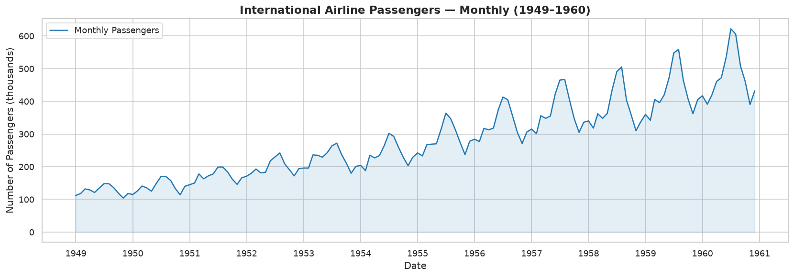
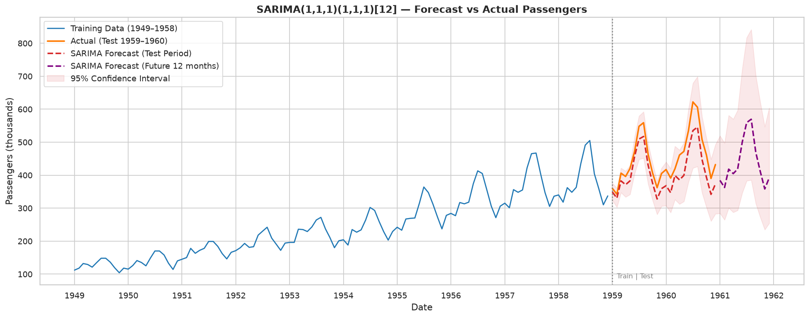

# AirPassengers: Time Series Analysis with Python & Power BI

An in-class workshop and portfolio project exploring **144 monthly airline passenger observations from January 1949 to December 1960**. Python provides the statistical analysis and SARIMA forecasting workflow; Power BI presents historical trends, annual totals and calendar-month seasonality.

[Explore the Python notebook](AirPassengers_TimeSeries_Portfolio.ipynb) · [Open the interactive Power BI report](https://app.powerbi.com/groups/1dab85b5-c696-42fa-968e-e7c235d246d0/reports/7599d9ce-23e5-4a92-94bb-cd67811139b4) · [Download the Power BI file](AirPassengers.pbix)

The hosted report may require sign-in and permission from its owner. The link does not grant access.



## Project questions

- How did passenger demand change across the 12 years?
- Which calendar months have the highest and lowest average demand?
- How can trend and annual seasonality be separated?
- How does a seasonal forecasting model perform on a later, held-out period?

## Python analysis

The [Jupyter notebook](AirPassengers_TimeSeries_Portfolio.ipynb) contains the following workflow:

| Stage | Methods and skills |
| --- | --- |
| Data preparation | CSV loading, column renaming, datetime parsing, monthly indexing and completeness checks |
| Exploration | Descriptive statistics, annual aggregation, calendar-month averages, rolling mean and standard deviation |
| Visualization | Time-series lines, year/month heatmap, monthly boxplots and seasonal averages |
| Decomposition | Multiplicative trend, seasonal and residual components with a 12-month period |
| Stationarity | Augmented Dickey–Fuller and KPSS tests, log transformation, seasonal and first-order differencing |
| Model diagnostics | ACF/PACF plots and SARIMA residual diagnostics |
| Forecasting | Log-scale SARIMA(1,1,1)(1,1,1)[12] fitted through Statsmodels |
| Evaluation | Chronological holdout and MAE, RMSE and MAPE calculations on the original value scale |

**Training period:** January 1949–December 1958 (120 months).  
**Test period:** January 1959–December 1960 (24 months).

The code forecasts 36 months from the end of training: the 24-month test period followed by 12 months in 1961. It plots exponentiated forecasts and interval bounds. The 1961 extension uses the same model fitted through 1958; it is not a refit on all observations through 1960.



### Verified forecast accuracy

The notebook was executed on **28 October 2026**: all **28 code cells** completed without errors and the SARIMA optimizer converged. Saved outputs include tables, stationarity tests, charts, the model summary and forecast evaluation.

| Metric | 24-month test period: January 1959–December 1960 |
| --- | ---: |
| MAE | 43.7323 |
| RMSE | 48.2498 |
| MAPE | 9.4826% |
| Training-fit AIC | -332.6217 |
| Training-fit BIC | -319.9587 |

The measured **9.48% MAPE** replaces the notebook's earlier unsupported below-5% claim. MAE and RMSE retain the CSV's original value scale. AIC/BIC describe the training fit, not test accuracy. These results verify this execution and historical split; they do not establish future performance or an unbiased model-selection evaluation.

[Exact metrics and package versions](execution_results.json) · [24 holdout observations, forecasts and interval bounds](holdout_predictions.csv)

## Power BI report

The [Power BI report guide](POWER_BI_REPORT.md) documents the hosted report and its three pages:

| Page | Purpose |
| --- | --- |
| Monthly trend | Explore the historical monthly series from 1949 to 1960 |
| Annual totals | Compare summed monthly values across years |
| Seasonality | Compare average values for each calendar month across all 12 years |

The report demonstrates time-based aggregation, trend communication and seasonal comparison. The SARIMA modeling workflow belongs to the Python notebook; the documented Power BI pages present historical data.

The report uses a **static CSV import**. Automatic refresh is not configured, so changing the repository CSV does not update the hosted report automatically.

## Findings from the source data

| Metric | Value |
| --- | ---: |
| Monthly observations | 144 |
| Annual total, 1949 | 1,520 |
| Annual total, 1960 | 5,714 |
| Annual-total compound growth, 1949–1960 | 12.8% |
| Annual growth in 1960 | 11.2% |
| Highest monthly observation | July 1960: 622 |
| Lowest monthly observation | November 1949: 104 |

Annual totals rise throughout the period. July and August have the highest calendar-month averages; November has the lowest. Seasonal swings become larger as the series level rises, motivating the notebook's multiplicative decomposition and log transformation.

These figures retain the CSV's original scale. Its headers do not specify a unit multiplier; some notebook chart labels describe the values as thousands.

## Run the Python notebook

1. Clone the repository and enter its directory:

   ```bash
   git clone https://github.com/meroebeigi/TimeseriesAnalysis-InclassWorkshop.git
   cd TimeseriesAnalysis-InclassWorkshop
   ```

2. Create and activate a Python virtual environment, then install the notebook dependencies:

   ```bash
   python -m venv .venv
   # Windows PowerShell
   .venv\Scripts\Activate.ps1
   # macOS / Linux: source .venv/bin/activate

   python -m pip install -r requirements.txt
   python -m pip install jupyterlab
   ```

3. Start JupyterLab:

   ```bash
   jupyter lab AirPassengers_TimeSeries_Portfolio.ipynb
   ```

4. Keep `AirPassengers.csv` beside the notebook and run all cells in order. The notebook reads the CSV using a relative path and writes PNG charts to the working directory. Running it can overwrite the existing chart exports.

The analysis dependencies are pinned in [requirements.txt](requirements.txt) to the versions used for the saved Python 3.12 execution. Package and platform differences can affect numerical results. Notebook cells were executed in order through IPython with captured text and rich display outputs; figures used Matplotlib’s Agg backend.

## Open the Power BI file

Download [AirPassengers.pbix](AirPassengers.pbix) and open it in Power BI Desktop. Use the [hosted report](https://app.powerbi.com/groups/1dab85b5-c696-42fa-968e-e7c235d246d0/reports/7599d9ce-23e5-4a92-94bb-cd67811139b4) for browser access with the appropriate permissions. See [POWER_BI_REPORT.md](POWER_BI_REPORT.md) for calculation definitions and refresh details.

## Repository contents

| File | Contents |
| --- | --- |
| [AirPassengers.csv](AirPassengers.csv) | Monthly source data: `Month` and `#Passengers` |
| [AirPassengers_TimeSeries_Portfolio.ipynb](AirPassengers_TimeSeries_Portfolio.ipynb) | Executed Python preparation, exploration, stationarity tests, modeling and evaluation with saved outputs |
| [AirPassengers.pbix](AirPassengers.pbix) | Downloadable Power BI report |
| [POWER_BI_REPORT.md](POWER_BI_REPORT.md) | Service report link, page descriptions, metrics and refresh notes |
| [execution_results.json](execution_results.json), [holdout_predictions.csv](holdout_predictions.csv) | Verified run metrics, versions and 24 test predictions |
| [requirements.txt](requirements.txt) | Pinned analysis dependencies for Python 3.12 |
| [raw_series.png](raw_series.png), [rolling_stats.png](rolling_stats.png) | Historical trend and rolling statistics |
| [heatmap.png](heatmap.png), [boxplot_month.png](boxplot_month.png), [monthly_avg_bar.png](monthly_avg_bar.png) | Seasonal views |
| [decomposition.png](decomposition.png), [acf_pacf.png](acf_pacf.png) | Decomposition and correlation diagnostics |
| [forecast.png](forecast.png), [residuals.png](residuals.png), [sarima_diagnostics.png](sarima_diagnostics.png) | Forecast and diagnostic chart exports |

## Interpretation and next steps

This historical workshop illustrates forecasting methods. Passenger demand alone does not establish airline profitability or investment suitability. The notebook uses one selected SARIMA specification without a benchmark comparison; its stationarity and ACF/PACF exploration precedes the train/test split. A stronger evaluation would select transformations and model settings using training data only, compare a seasonal-naive baseline, and use rolling-origin validation.

Exponentiating a log-scale point forecast does not provide a bias-adjusted mean forecast. Forecast intervals also depend on model assumptions and do not account for every possible structural change.

Potential extensions include baseline comparisons, training-only model selection, a final refit through 1960, and exporting validated forecasts for a separate Power BI forecast page.

---

Created by **Meroe Asgharbeigi**.

